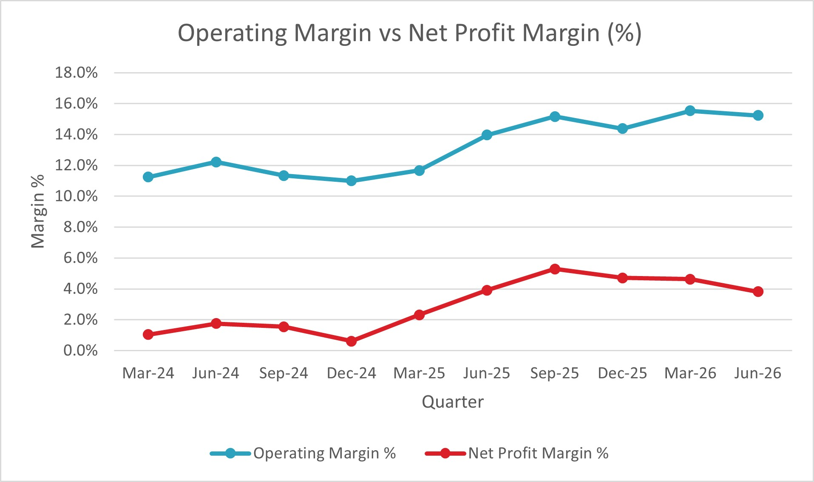

# Company Financial Performance Analysis: Tata Steel (Quarterly)

An Excel analysis of Tata Steel's quarterly financial results over 10 quarters (Mar 2024 to Jun 2026), covering revenue, expenses, operating profit, net profit, margins and growth.

## Objective
To understand how the company's profitability changed from quarter to quarter, and whether margins improved or fell.

## Data
- **Source:** Screener.in, "Export to Excel" feature (quarterly results)
- **Company:** Tata Steel (consolidated figures)
- **Period:** 10 quarters, Mar 2024 to Jun 2026 (each label is the last month of the quarter)
- **Unit:** ₹ crore
- **Raw data:** kept unedited in the `Raw Data` sheet

## Workbook structure
| Sheet | Purpose |
|---|---|
| Raw Data | Original Screener export, not edited |
| Analysis | Quarterly table with formulas, conditional formatting and 3 charts |
| Summary | Key results calculated with formulas |
| Sorted_Filtered | Values-only copy of the table, sorted by operating margin and filtered to below-average quarters |

The workbook also contains the other tabs that came with the Screener export (Profit & Loss, Quarters, Balance Sheet, Cash Flow, Customization), which were not changed.

## Methods (Excel formulas)
- **Operating Profit** = Revenue - Expenses
- **Operating Margin %** = Operating Profit / Revenue
- **Net Profit Margin %** = Net Profit / Revenue
- **Expense Ratio %** = Expenses / Revenue
- **QoQ Revenue Growth %** = change from the previous quarter
- **YoY Revenue Growth %** = change from the same quarter a year earlier (available from Mar 2025)
- **Operating Margin Change** = change in margin from the previous quarter
- **Summary sheet:** MAX, MIN, AVERAGE, INDEX/MATCH, COUNT and COUNTIF
- **Conditional formatting:** a color scale on operating margin, and red highlighting where the margin fell
- **Sorting and filtering:** done on a values-only copy, because sorting the original would break the formulas that refer to neighboring rows

## Charts

## Key results
| Measure | Value |
|---|---|
| Highest operating margin | 15.5% (Mar 2026) |
| Lowest operating margin | 11.0% (Dec 2024) |
| Average operating margin | 13.2% |
| Latest operating margin | 15.2% (Jun 2026) |
| Revenue change, Mar 2024 to Jun 2026 | +3.6% |
| Quarters where margin fell | 4 of 9 comparisons |

## Key findings
1. **Operating margin improved**, from 11.2% in Mar 2024 to 15.2% in Jun 2026, a gain of about 4 percentage points.
2. **Revenue was nearly flat, but operating profit grew.** Revenue rose only 3.6% (₹58,687 crore to ₹60,794 crore), while operating profit rose about 40% (₹6,601 crore to ₹9,264 crore).
3. **Costs fell relative to sales.** The expense ratio dropped from 88.8% to 84.8%, which explains the better margin.
4. **Net profit is much smaller than operating profit.** In Mar 2024, operating profit was ₹6,601 crore but net profit was ₹611 crore. Items such as depreciation, interest and tax sit in between, but this project did not measure how much each contributed.
5. **The margin fell in 4 of 9 quarter-to-quarter changes** (Sep 2024, Dec 2024, Dec 2025, Jun 2026). Revenue in Jun 2026 was 14.3% higher than in Jun 2025.
6. **Five quarters were below the average margin:** Mar 2024 to Mar 2025.

## Limitations
- Only 10 quarters (about 2.5 years), so the trend may not hold over a longer period.
- YoY growth is available only from Mar 2025, because earlier quarters have no year-ago data.
- Operating Profit here is Revenue minus Expenses as given by Screener, so it excludes other income.
- The reasons behind the changes (steel prices, raw material costs and so on) were not tested.
- This is a descriptive analysis, not investment advice.

## Tools
Microsoft Excel (formulas, charts, conditional formatting, sorting and filtering), Screener.in
